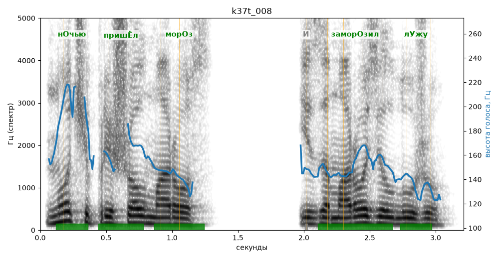

# k37t_008

Голос: **Топа, сборка 37f** · длительность 3.2 с
Эталон: Ночью пришёл мороз. И заморозил лужу.
Распознано: Ночью пришел мороз и заморозил лужу.
Слова: все совпали

## Ударения
(где нужно: ruaccent)

| слово | нужно | у голоса | |
|---|---|---|---|
| ночью | нОчью | нОчью | ✓ |
| пришёл | пришЁл | пришЁл | ✓ |
| мороз | морОз | морОз | ✓ |
| заморозил | заморОзил | заморОзил | ✓ |
| лужу | лУжу | лУжу | ✓ |

## Интонация
- ✓ «ночью пришёл мороз.» — конец фразы понижается — звучит законченно
- ✓ «и заморозил лужу.» — конец фразы понижается — звучит законченно
- Диапазон голоса 7.7 полутонов (живо), средняя высота 148 Гц

## Паузы и темп
- паузы на своих местах
- Темп 5.7 слога/с (нормально)

_Синяя линия — высота голоса. Над словами заглавная буква — где ударение должно быть; красным — голос поставил не туда (уверенно), оранжевым — возможно._
