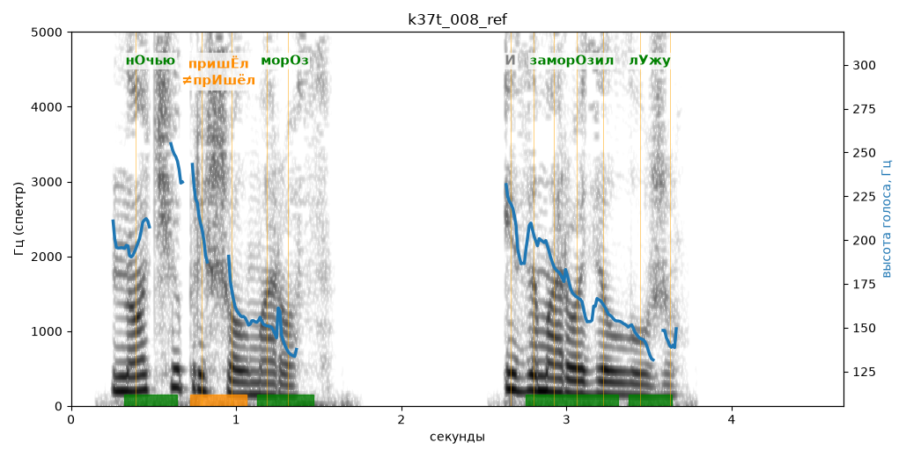

# k37t_008_ref

Голос: **edge:ru-RU-SvetlanaNeural** · длительность 4.7 с
Эталон: Ночью пришёл мороз. И заморозил лужу.
Распознано: ночью пришел мороз и заморозил лужу
Слова: все совпали

## Ударения
(где нужно: ruaccent)

| слово | нужно | у голоса | |
|---|---|---|---|
| ночью | нОчью | нОчью | ✓ |
| пришёл | пришЁл | прИшёл | ✗? возможно — послушать |
| мороз | морОз | морОз | ✓ |
| заморозил | заморОзил | заморОзил | ✓ |
| лужу | лУжу | лУжу | ✓ |

## Интонация
- ✓ «ночью пришёл мороз.» — конец фразы понижается — звучит законченно
- ✓ «и заморозил лужу.» — конец фразы понижается — звучит законченно
- Диапазон голоса 9.0 полутонов (живо), средняя высота 166 Гц

## Паузы и темп
- паузы на своих местах
- Темп 5.6 слога/с (нормально)

_Синяя линия — высота голоса. Над словами заглавная буква — где ударение должно быть; красным — голос поставил не туда (уверенно), оранжевым — возможно._
