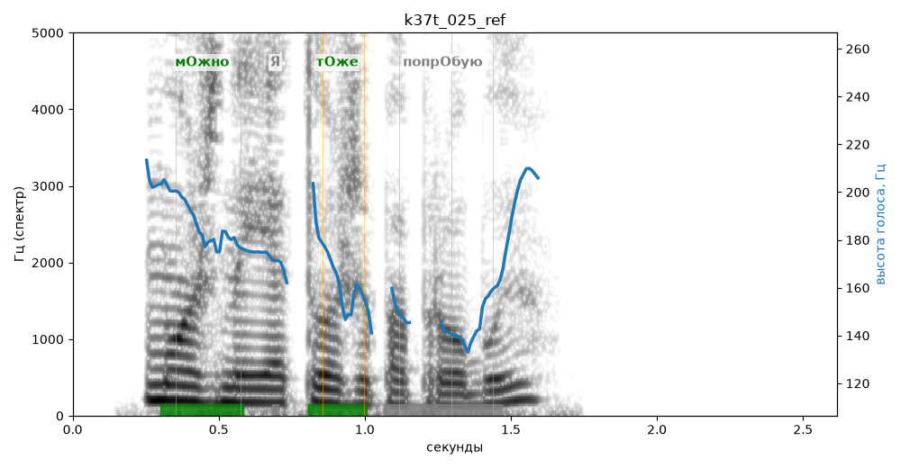

# k37t_025_ref

Голос: **edge:ru-RU-SvetlanaNeural** · длительность 2.6 с
Эталон: Можно я тоже попробую?
Распознано: Можно я тоже попробую?
Слова: все совпали

## Ударения
(где нужно: ruaccent)

| слово | нужно | у голоса | |
|---|---|---|---|
| можно | мОжно | мОжно | ✓ |
| тоже | тОже | тОже | ✓ |
| попробую | попрОбую | — | ? |

## Интонация
- ✗ «можно я тоже попробую?» — нет вопросительного подъёма (самое высокое место — «можно», в начале) — звучит как утверждение
- Диапазон голоса 6.8 полутонов (нормально), средняя высота 175 Гц

## Паузы и темп
- паузы на своих местах
- Темп 6.0 слога/с (нормально)

_Синяя линия — высота голоса. Над словами заглавная буква — где ударение должно быть; красным — голос поставил не туда (уверенно), оранжевым — возможно._
