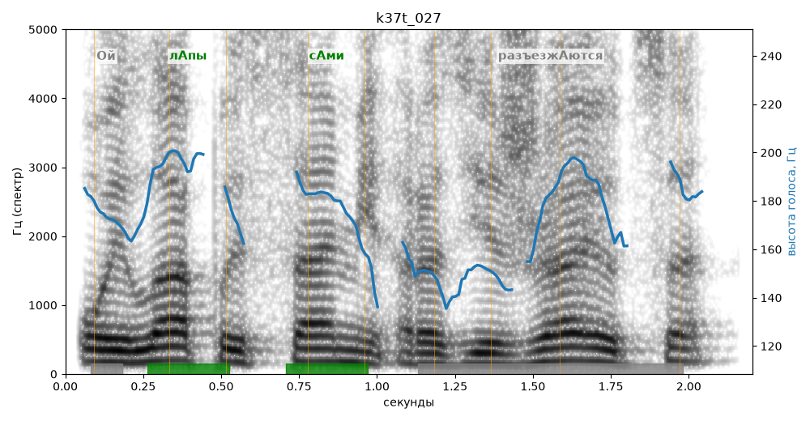

# k37t_027

Голос: **Топа, сборка 37f** · длительность 2.2 с
Эталон: Ой! Лапы сами разъезжаются!
Распознано: Ой лапы сами разъезжаются.
Слова: все совпали

## Ударения
(где нужно: ruaccent)

| слово | нужно | у голоса | |
|---|---|---|---|
| лапы | лАпы | лАпы | ✓ |
| сами | сАми | сАми | ✓ |
| разъезжаются | разъезжАются | — | ? |

## Интонация
- ✗ «лапы сами разъезжаются!» — восклицание звучит ровно, без эмоции
- Диапазон голоса 5.6 полутонов (нормально), средняя высота 175 Гц

## Паузы и темп
- после «ой!» пауза всего 0.08 с — фразы слипаются
- Темп 5.8 слога/с (нормально)

_Синяя линия — высота голоса. Над словами заглавная буква — где ударение должно быть; красным — голос поставил не туда (уверенно), оранжевым — возможно._
