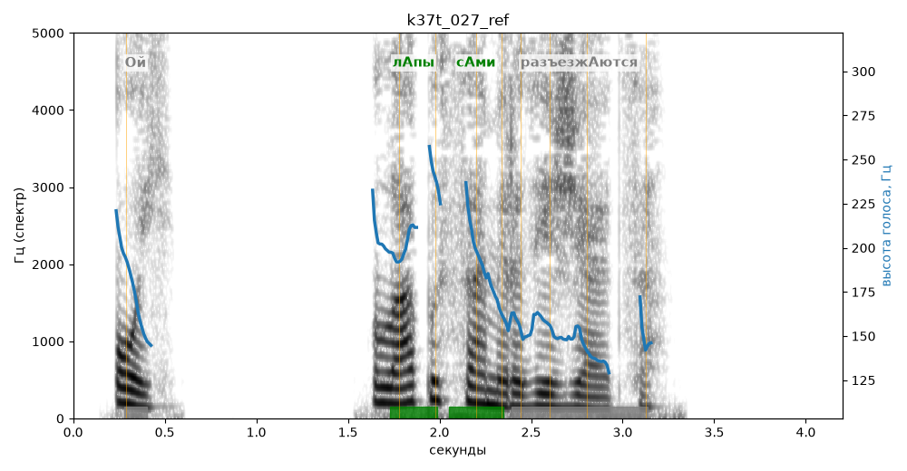

# k37t_027_ref

Голос: **edge:ru-RU-SvetlanaNeural** · длительность 4.2 с
Эталон: Ой! Лапы сами разъезжаются!
Распознано: Ой! Лапа сами разъезжаются.
Расхождения в словах: «лапы» → «лапа»

## Ударения
(где нужно: ruaccent)

| слово | нужно | у голоса | |
|---|---|---|---|
| лапы | лАпы | лАпы | ✓ |
| сами | сАми | сАми | ✓ |
| разъезжаются | разъезжАются | — | ? |

## Интонация
- ✓ «лапы сами разъезжаются!» — выделено слово «лапы» (+3.8 пт)
- Диапазон голоса 9.2 полутонов (живо), средняя высота 163 Гц

## Паузы и темп
- паузы на своих местах
- Темп 5.9 слога/с (нормально)

_Синяя линия — высота голоса. Над словами заглавная буква — где ударение должно быть; красным — голос поставил не туда (уверенно), оранжевым — возможно._
