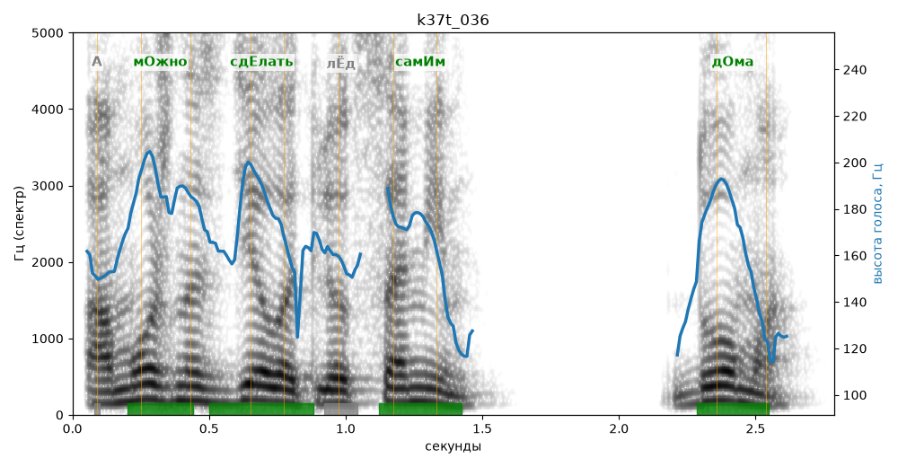

# k37t_036

Голос: **Топа, сборка 37f** · длительность 2.8 с
Эталон: А можно сделать лёд самим? Дома?
Распознано: А можно сделать лед самим дома.
Слова: все совпали

## Ударения
(где нужно: ruaccent)

| слово | нужно | у голоса | |
|---|---|---|---|
| можно | мОжно | мОжно | ✓ |
| сделать | сдЕлать | сдЕлать | ✓ |
| самим | самИм | самИм | ✓ |
| дома | дОма | дОма | ✓ |

## Интонация
- ✗ «а можно сделать лёд самим?» — нет вопросительного подъёма (самое высокое место — «можно», в начале) — звучит как утверждение
- Диапазон голоса 8.0 полутонов (живо), средняя высота 166 Гц

## Паузы и темп
- паузы на своих местах
- Темп 6.2 слога/с (нормально)

_Синяя линия — высота голоса. Над словами заглавная буква — где ударение должно быть; красным — голос поставил не туда (уверенно), оранжевым — возможно._
