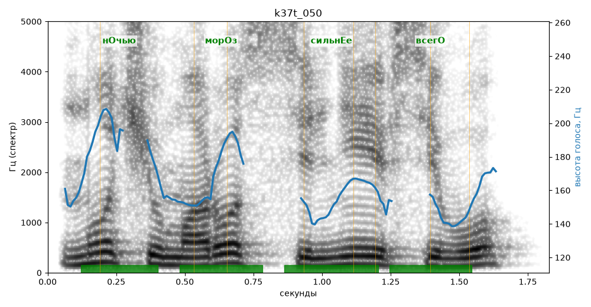

# k37t_050

Голос: **Топа, сборка 37f** · длительность 1.8 с
Эталон: Ночью мороз сильнее всего.
Распознано: ночью мороз сильнее всего.
Слова: все совпали

## Ударения
(где нужно: ruaccent)

| слово | нужно | у голоса | |
|---|---|---|---|
| ночью | нОчью | нОчью | ✓ |
| мороз | морОз | морОз | ✓ |
| сильнее | сильнЕе | сильнЕе | ✓ |
| всего | всегО | всегО | ✓ |

## Интонация
- ✗ «ночью мороз сильнее всего.» — конец фразы не понижается — звучит незаконченно / как перечисление
- Диапазон голоса 5.8 полутонов (нормально), средняя высота 157 Гц

## Паузы и темп
- паузы на своих местах
- Темп 5.6 слога/с (нормально)

_Синяя линия — высота голоса. Над словами заглавная буква — где ударение должно быть; красным — голос поставил не туда (уверенно), оранжевым — возможно._
