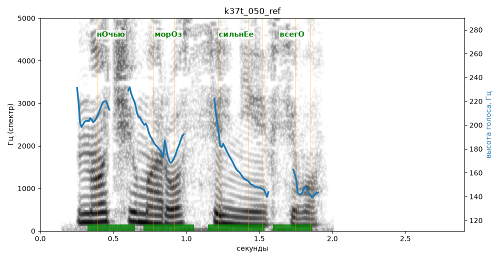

# k37t_050_ref

Голос: **edge:ru-RU-SvetlanaNeural** · длительность 2.9 с
Эталон: Ночью мороз сильнее всего.
Распознано: Ночью мороз сильнее всего.
Слова: все совпали

## Ударения
(где нужно: ruaccent)

| слово | нужно | у голоса | |
|---|---|---|---|
| ночью | нОчью | нОчью | ✓ |
| мороз | морОз | морОз | ✓ |
| сильнее | сильнЕе | сильнЕе | ✓ |
| всего | всегО | всегО | ✓ |

## Интонация
- ✓ «ночью мороз сильнее всего.» — конец фразы понижается — звучит законченно
- Диапазон голоса 7.6 полутонов (живо), средняя высота 181 Гц

## Паузы и темп
- паузы на своих местах
- Темп 5.2 слога/с (нормально)

_Синяя линия — высота голоса. Над словами заглавная буква — где ударение должно быть; красным — голос поставил не туда (уверенно), оранжевым — возможно._
