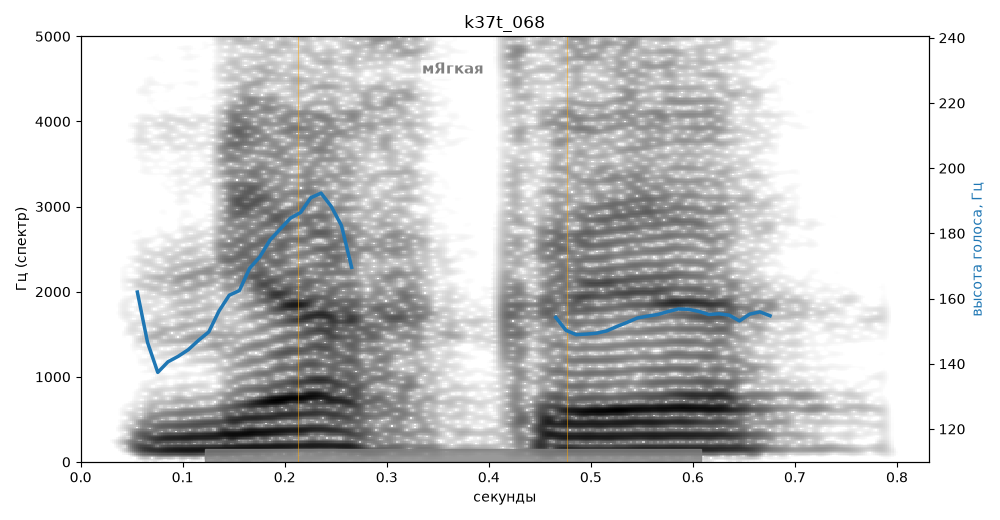

# k37t_068

Голос: **Топа, сборка 37f** · длительность 0.8 с
Эталон: Мягкая!
Распознано: Мягкая.
Слова: все совпали

## Ударения
(где нужно: ruaccent)

| слово | нужно | у голоса | |
|---|---|---|---|
| мягкая | мЯгкая | — | ? |

## Интонация
- Диапазон голоса 4.8 полутонов (нормально), средняя высота 155 Гц

## Паузы и темп
- паузы на своих местах
- Темп 4.1 слога/с (нормально)

_Синяя линия — высота голоса. Над словами заглавная буква — где ударение должно быть; красным — голос поставил не туда (уверенно), оранжевым — возможно._
