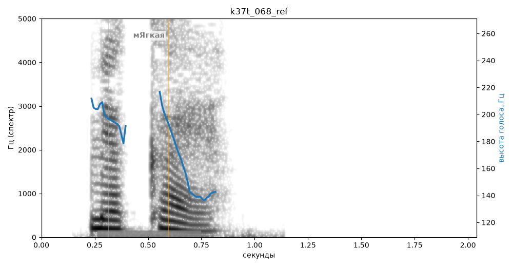

# k37t_068_ref

Голос: **edge:ru-RU-SvetlanaNeural** · длительность 2.0 с
Эталон: Мя́гкая!
Распознано: Мякая
Расхождения в словах: «мя гкая» → «мякая»

## Ударения
(где нужно: дано в тексте)

| слово | нужно | у голоса | |
|---|---|---|---|
| мягкая | мЯгкая | — | ? |

## Интонация
- Диапазон голоса 7.1 полутонов (живо), средняя высота 185 Гц

## Паузы и темп
- паузы на своих местах
- Темп 4.1 слога/с (нормально)

_Синяя линия — высота голоса. Над словами заглавная буква — где ударение должно быть; красным — голос поставил не туда (уверенно), оранжевым — возможно._
