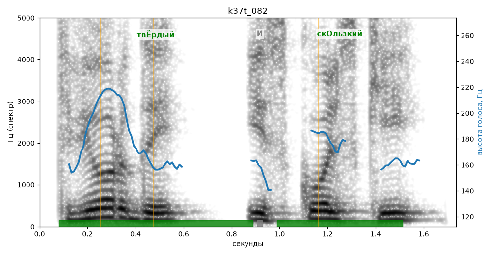

# k37t_082

Голос: **Топа, сборка 37f** · длительность 1.7 с
Эталон: Твёрдый! И скользкий!
Распознано: тверды из кольский.
Расхождения в словах: «твердый и скользкий» → «тверды из кольский»

## Ударения
(где нужно: ruaccent)

| слово | нужно | у голоса | |
|---|---|---|---|
| твёрдый | твЁрдый | твЁрдый | ✓ |
| скользкий | скОльзкий | скОльзкий | ✓ |

## Интонация
- ✓ «и скользкий!» — выделено слово «скользкий» (+2.2 пт)
- Диапазон голоса 5.9 полутонов (нормально), средняя высота 165 Гц

## Паузы и темп
- после «твёрдый!» пауза всего 0.02 с — фразы слипаются
- Темп 3.5 слога/с (медленно)

_Синяя линия — высота голоса. Над словами заглавная буква — где ударение должно быть; красным — голос поставил не туда (уверенно), оранжевым — возможно._
