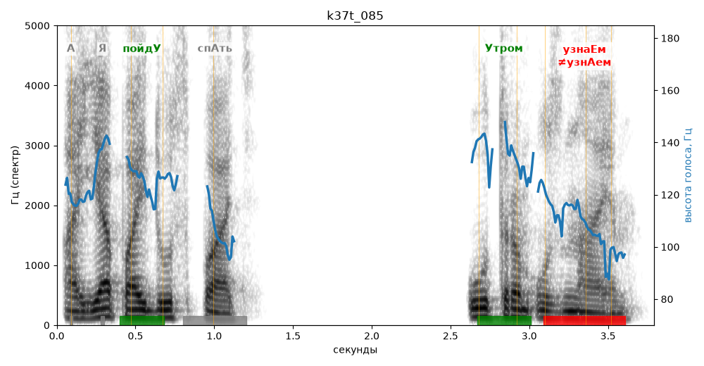

# k37t_085

Голос: **Топа, сборка 37f** · длительность 3.8 с
Эталон: А я пойду спать. Утром узнаем.
Распознано: а я пойду спать. Утром узнаем.
Слова: все совпали

## Ударения
(где нужно: ruaccent)

| слово | нужно | у голоса | |
|---|---|---|---|
| пойду | пойдУ | пойдУ | ✓ |
| утром | Утром | Утром | ✓ |
| узнаем | узнаЕм | узнАем | ✗ ОШИБКА |

## Интонация
- ✓ «а я пойду спать.» — конец фразы понижается — звучит законченно
- ✓ «утром узнаем.» — конец фразы понижается — звучит законченно
- Диапазон голоса 6.5 полутонов (нормально), средняя высота 120 Гц

## Паузы и темп
- паузы на своих местах
- Темп 4.8 слога/с (нормально)

_Синяя линия — высота голоса. Над словами заглавная буква — где ударение должно быть; красным — голос поставил не туда (уверенно), оранжевым — возможно._
