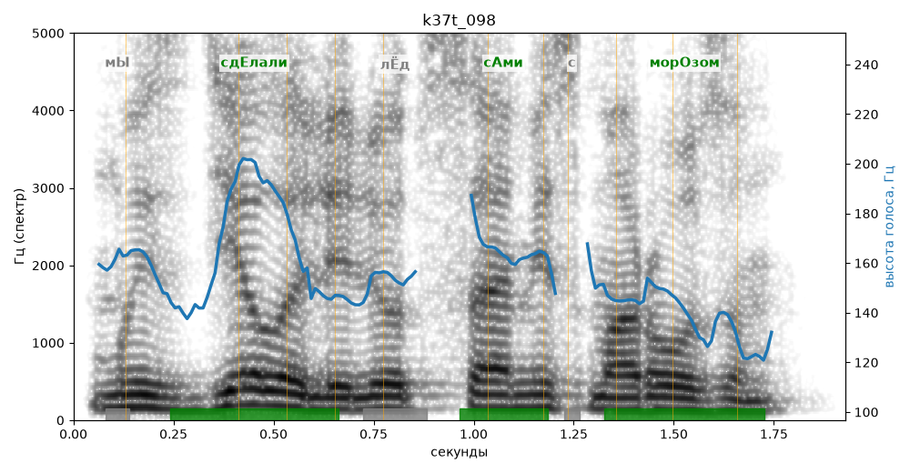

# k37t_098

Голос: **Топа, сборка 37f** · длительность 1.9 с
Эталон: Мы сделали лёд сами! С морозом.
Распознано: Мы сделали лед самес морозом.
Расхождения в словах: «сами с» → «самес»

## Ударения
(где нужно: ruaccent)

| слово | нужно | у голоса | |
|---|---|---|---|
| сделали | сдЕлали | сдЕлали | ✓ |
| сами | сАми | сАми | ✓ |
| морозом | морОзом | морОзом | ✓ |

## Интонация
- ✗ «мы сделали лёд сами!» — восклицание звучит ровно, без эмоции
- ✗ «с морозом.» — конец фразы не понижается — звучит незаконченно / как перечисление
- Диапазон голоса 7.3 полутонов (живо), средняя высота 152 Гц

## Паузы и темп
- после «сами!» пауза всего 0.04 с — фразы слипаются
- Темп 6.7 слога/с (быстро)

_Синяя линия — высота голоса. Над словами заглавная буква — где ударение должно быть; красным — голос поставил не туда (уверенно), оранжевым — возможно._
