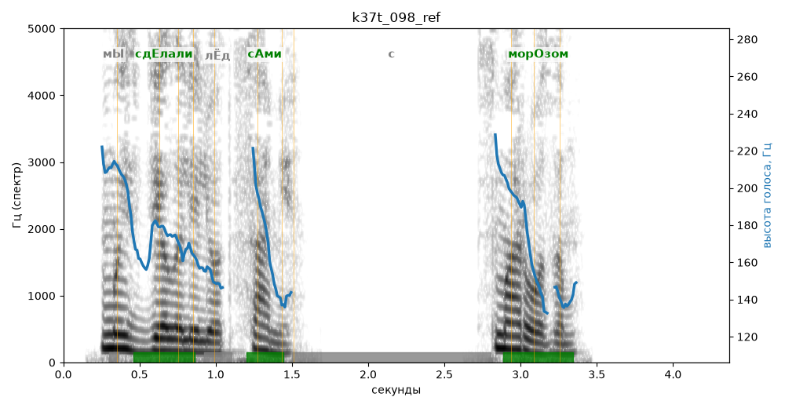

# k37t_098_ref

Голос: **edge:ru-RU-SvetlanaNeural** · длительность 4.4 с
Эталон: Мы сделали лёд сами! С морозом.
Распознано: Мы сделали лед сами. С морозом.
Слова: все совпали

## Ударения
(где нужно: ruaccent)

| слово | нужно | у голоса | |
|---|---|---|---|
| сделали | сдЕлали | сдЕлали | ✓ |
| сами | сАми | сАми | ✓ |
| морозом | морОзом | морОзом | ✓ |

## Интонация
- ✓ «мы сделали лёд сами!» — выделено слово «мы» (+3.2 пт)
- ✗ «с морозом.» — конец фразы не понижается — звучит незаконченно / как перечисление
- Диапазон голоса 7.6 полутонов (живо), средняя высота 168 Гц

## Паузы и темп
- после «сами!» пауза всего 0.06 с — фразы слипаются
- Темп 3.6 слога/с (медленно)

_Синяя линия — высота голоса. Над словами заглавная буква — где ударение должно быть; красным — голос поставил не туда (уверенно), оранжевым — возможно._
