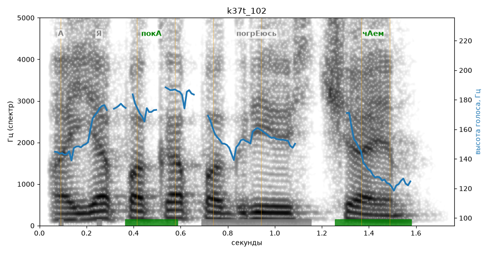

# k37t_102

Голос: **Топа, сборка 37f** · длительность 1.8 с
Эталон: А я пока погреюсь чаем.
Распознано: А я пока погреюсь чаем.
Слова: все совпали

## Ударения
(где нужно: ruaccent)

| слово | нужно | у голоса | |
|---|---|---|---|
| пока | покА | покА | ✓ |
| погреюсь | погрЕюсь | — | ? |
| чаем | чАем | чАем | ✓ |

## Интонация
- ✓ «а я пока погреюсь чаем.» — конец фразы понижается — звучит законченно
- Диапазон голоса 7.1 полутонов (живо), средняя высота 153 Гц

## Паузы и темп
- паузы на своих местах
- Темп 4.7 слога/с (нормально)

_Синяя линия — высота голоса. Над словами заглавная буква — где ударение должно быть; красным — голос поставил не туда (уверенно), оранжевым — возможно._
