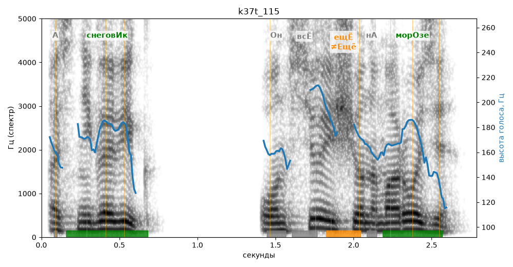

# k37t_115

Голос: **Топа, сборка 37f** · длительность 2.8 с
Эталон: А снеговик? Он всё ещё на морозе?
Распознано: Оснеговик, он все еще на морозе.
Расхождения в словах: «а снеговик» → «оснеговик»

## Ударения
(где нужно: ruaccent)

| слово | нужно | у голоса | |
|---|---|---|---|
| снеговик | снеговИк | снеговИк | ✓ |
| ещё | ещЁ | Ещё | ✗? возможно — послушать |
| морозе | морОзе | морОзе | ✓ |

## Интонация
- ✗ «а снеговик?» — нет вопросительного подъёма (самое высокое место — «снеговик», в начале) — звучит как утверждение
- ✓ «он всё ещё на морозе?» — вопросительный подъём на слове «всё»
- Диапазон голоса 7.0 полутонов (живо), средняя высота 167 Гц

## Паузы и темп
- паузы на своих местах
- Темп 7.0 слога/с (быстро)

_Синяя линия — высота голоса. Над словами заглавная буква — где ударение должно быть; красным — голос поставил не туда (уверенно), оранжевым — возможно._
