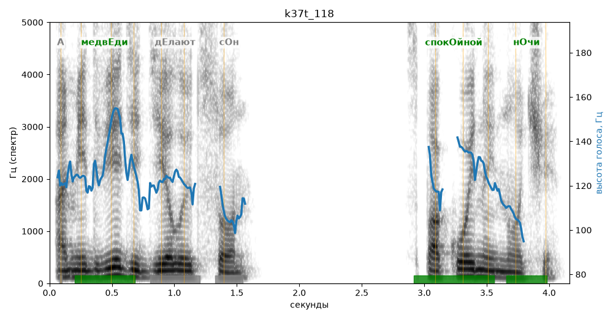

# k37t_118

Голос: **Топа, сборка 37f** · длительность 4.2 с
Эталон: А медведи делают сон. Спокойной ночи.
Распознано: А медведи делают сон. Спокойной ночи.
Слова: все совпали

## Ударения
(где нужно: ruaccent)

| слово | нужно | у голоса | |
|---|---|---|---|
| медведи | медвЕди | медвЕди | ✓ |
| делают | дЕлают | — | ? |
| спокойной | спокОйной | спокОйной | ✓ |
| ночи | нОчи | нОчи | ✓ |

## Интонация
- ✓ «а медведи делают сон.» — конец фразы понижается — звучит законченно
- ✓ «спокойной ночи.» — конец фразы понижается — звучит законченно
- Диапазон голоса 5.6 полутонов (нормально), средняя высота 122 Гц

## Паузы и темп
- паузы на своих местах
- Темп 4.7 слога/с (нормально)

_Синяя линия — высота голоса. Над словами заглавная буква — где ударение должно быть; красным — голос поставил не туда (уверенно), оранжевым — возможно._
