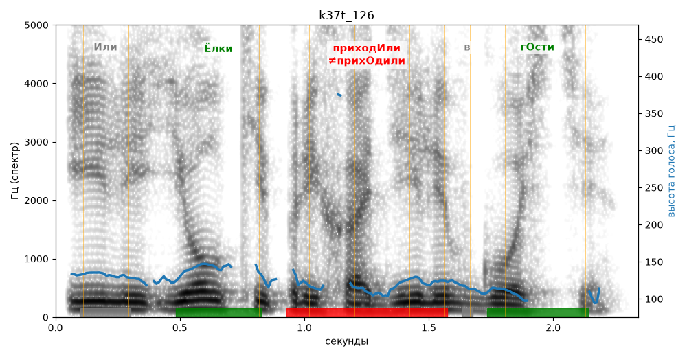

# k37t_126

Голос: **Топа, сборка 37f** · длительность 2.3 с
Эталон: Или ёлки приходили в гости.
Распознано: или ёлки приходили в гости.
Слова: все совпали

## Ударения
(где нужно: ruaccent)

| слово | нужно | у голоса | |
|---|---|---|---|
| или | Или | илИ | ? не разобрать |
| ёлки | Ёлки | Ёлки | ✓ |
| приходили | приходИли | прихОдили | ✗ ОШИБКА |
| гости | гОсти | гОсти | ✓ |

## Интонация
- ✓ «или ёлки приходили в гости.» — конец фразы понижается — звучит законченно
- Диапазон голоса 5.8 полутонов (нормально), средняя высота 124 Гц

## Паузы и темп
- паузы на своих местах
- Темп 5.9 слога/с (нормально)

_Синяя линия — высота голоса. Над словами заглавная буква — где ударение должно быть; красным — голос поставил не туда (уверенно), оранжевым — возможно._
