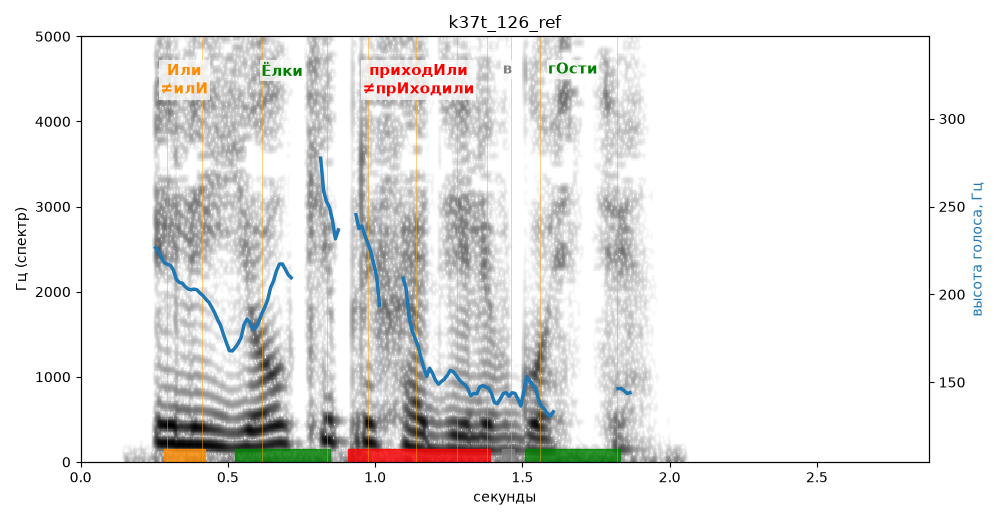

# k37t_126_ref

Голос: **edge:ru-RU-SvetlanaNeural** · длительность 2.9 с
Эталон: Или ёлки приходили в гости.
Распознано: или елки приходили в гости.
Слова: все совпали

## Ударения
(где нужно: ruaccent)

| слово | нужно | у голоса | |
|---|---|---|---|
| или | Или | илИ | ✗? возможно — послушать |
| ёлки | Ёлки | Ёлки | ✓ |
| приходили | приходИли | прИходили | ✗ ОШИБКА |
| гости | гОсти | гОсти | ✓ |

## Интонация
- ✓ «или ёлки приходили в гости.» — конец фразы понижается — звучит законченно
- Диапазон голоса 9.5 полутонов (живо), средняя высота 178 Гц

## Паузы и темп
- паузы на своих местах
- Темп 7.1 слога/с (быстро)

_Синяя линия — высота голоса. Над словами заглавная буква — где ударение должно быть; красным — голос поставил не туда (уверенно), оранжевым — возможно._
