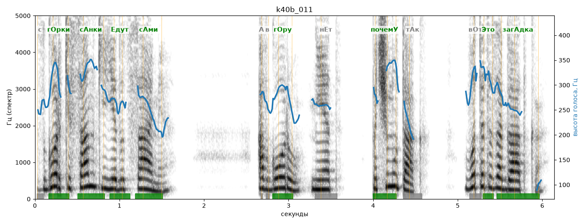

# k40b_011

Эталон: С горки санки едут сами. А в гору — нет. Почему так? Вот это загадка!
Распознано: с горки санки едут сами. А в гору нет. Почему так? Вот эта загадка.
Расхождения в словах: «это» → «эта»

## Ударения
(где нужно: ruaccent)

| слово | нужно | у голоса | |
|---|---|---|---|
| горки | гОрки | гОрки | ✓ |
| санки | сАнки | сАнки | ✓ |
| едут | Едут | Едут | ✓ |
| сами | сАми | сАми | ✓ |
| гору | гОру | гОру | ✓ |
| почему | почемУ | почемУ | ✓ |
| это | Это | Это | ✓ |
| загадка | загАдка | загАдка | ✓ |

## Интонация
- ✗ «с горки санки едут сами.» — конец фразы не понижается — звучит незаконченно / как перечисление
- ✗ «а в гору нет.» — конец фразы не понижается — звучит незаконченно / как перечисление
- ✓ «почему так?» — конец фразы понижается — звучит законченно
- ✓ «вот это загадка!» — выделено слово «это» (+2.6 пт)
- Диапазон голоса 8.8 полутонов (живо), средняя высота 271 Гц

## Паузы и темп
- паузы на своих местах
- Темп 6.8 слога/с (быстро)

_Синяя линия — высота голоса. Над словами заглавная буква — где ударение должно быть; красным — голос поставил не туда (уверенно), оранжевым — возможно._
