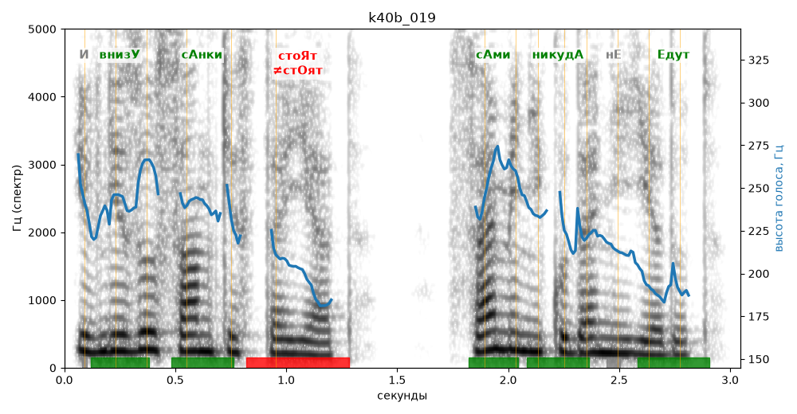

# k40b_019

Эталон: И внизу санки стоят. Сами никуда не едут.
Распознано: И внизу санки стоят. Саме никуда не едут.
Расхождения в словах: «сами» → «саме»

## Ударения
(где нужно: ruaccent)

| слово | нужно | у голоса | |
|---|---|---|---|
| внизу | внизУ | внизУ | ✓ |
| санки | сАнки | сАнки | ✓ |
| стоят | стоЯт | стОят | ✗ ОШИБКА |
| сами | сАми | сАми | ✓ |
| никуда | никудА | никудА | ✓ |
| едут | Едут | Едут | ✓ |

## Интонация
- ✗ «и внизу санки стоят.» — конец фразы не понижается — звучит незаконченно / как перечисление
- ✓ «сами никуда не едут.» — конец фразы понижается — звучит законченно
- Диапазон голоса 6.2 полутонов (нормально), средняя высота 228 Гц

## Паузы и темп
- паузы на своих местах
- Темп 6.1 слога/с (нормально)

_Синяя линия — высота голоса. Над словами заглавная буква — где ударение должно быть; красным — голос поставил не туда (уверенно), оранжевым — возможно._
