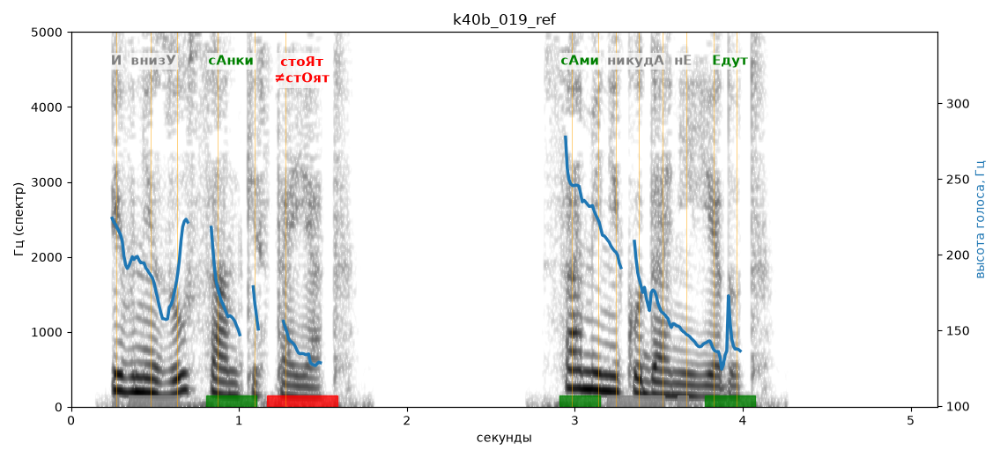

# k40b_019_ref

Голос: **edge:ru-RU-SvetlanaNeural** · длительность 5.2 с
Эталон: И внизу санки стоят. Сами никуда не едут.
Распознано: И внизу сонки стоят. Сами никуда не едут.
Расхождения в словах: «санки» → «сонки»

## Ударения
(где нужно: ruaccent)

| слово | нужно | у голоса | |
|---|---|---|---|
| внизу | внизУ | внИзу | ? не разобрать |
| санки | сАнки | сАнки | ✓ |
| стоят | стоЯт | стОят | ✗ ОШИБКА |
| сами | сАми | сАми | ✓ |
| никуда | никудА | нИкуда | ? не разобрать |
| едут | Едут | Едут | ✓ |

## Интонация
- ✓ «и внизу санки стоят.» — конец фразы понижается — звучит законченно
- ✓ «сами никуда не едут.» — конец фразы понижается — звучит законченно
- Диапазон голоса 10.1 полутонов (живо), средняя высота 167 Гц

## Паузы и темп
- паузы на своих местах
- Темп 6.0 слога/с (нормально)

_Синяя линия — высота голоса. Над словами заглавная буква — где ударение должно быть; красным — голос поставил не туда (уверенно), оранжевым — возможно._
