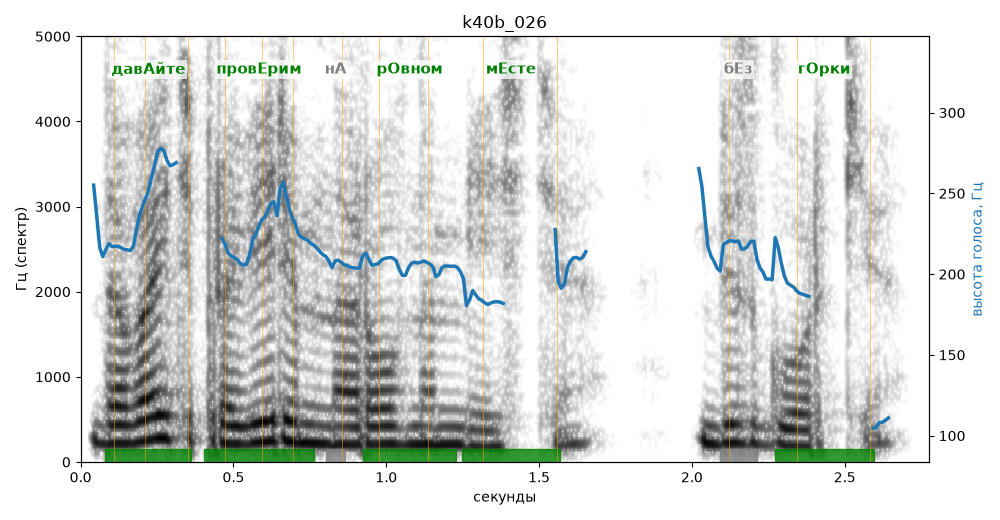

# k40b_026

Эталон: Давайте проверим на ровном месте. Без горки.
Распознано: Давайте проверим на ровном месте без горки.
Слова: все совпали

## Ударения
(где нужно: ruaccent)

| слово | нужно | у голоса | |
|---|---|---|---|
| давайте | давАйте | давАйте | ✓ |
| проверим | провЕрим | провЕрим | ✓ |
| ровном | рОвном | рОвном | ✓ |
| месте | мЕсте | мЕсте | ✓ |
| горки | гОрки | гОрки | ✓ |

## Интонация
- ✓ «давайте проверим на ровном месте.» — конец фразы понижается — звучит законченно
- ✗ «без горки.» — конец фразы не понижается — звучит незаконченно / как перечисление
- Диапазон голоса 6.3 полутонов (нормально), средняя высота 210 Гц

## Паузы и темп
- паузы на своих местах
- Темп 7.0 слога/с (быстро)

_Синяя линия — высота голоса. Над словами заглавная буква — где ударение должно быть; красным — голос поставил не туда (уверенно), оранжевым — возможно._
