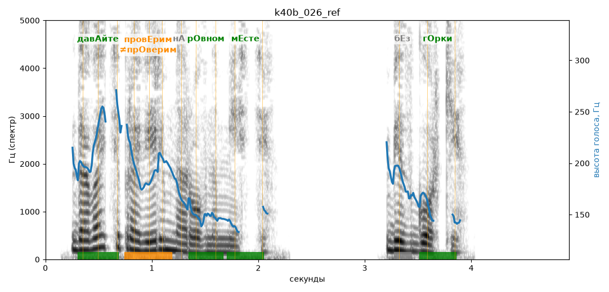

# k40b_026_ref

Голос: **edge:ru-RU-SvetlanaNeural** · длительность 4.9 с
Эталон: Давайте проверим на ровном месте. Без горки.
Распознано: Давайте проверим на ровном месте. Без горки.
Слова: все совпали

## Ударения
(где нужно: ruaccent)

| слово | нужно | у голоса | |
|---|---|---|---|
| давайте | давАйте | давАйте | ✓ |
| проверим | провЕрим | прОверим | ✗? возможно — послушать |
| ровном | рОвном | рОвном | ✓ |
| месте | мЕсте | мЕсте | ✓ |
| горки | гОрки | гОрки | ✓ |

## Интонация
- ✓ «давайте проверим на ровном месте.» — конец фразы понижается — звучит законченно
- ✗ «без горки.» — конец фразы не понижается — звучит незаконченно / как перечисление
- Диапазон голоса 9.2 полутонов (живо), средняя высота 176 Гц

## Паузы и темп
- паузы на своих местах
- Темп 6.0 слога/с (нормально)

_Синяя линия — высота голоса. Над словами заглавная буква — где ударение должно быть; красным — голос поставил не туда (уверенно), оранжевым — возможно._
