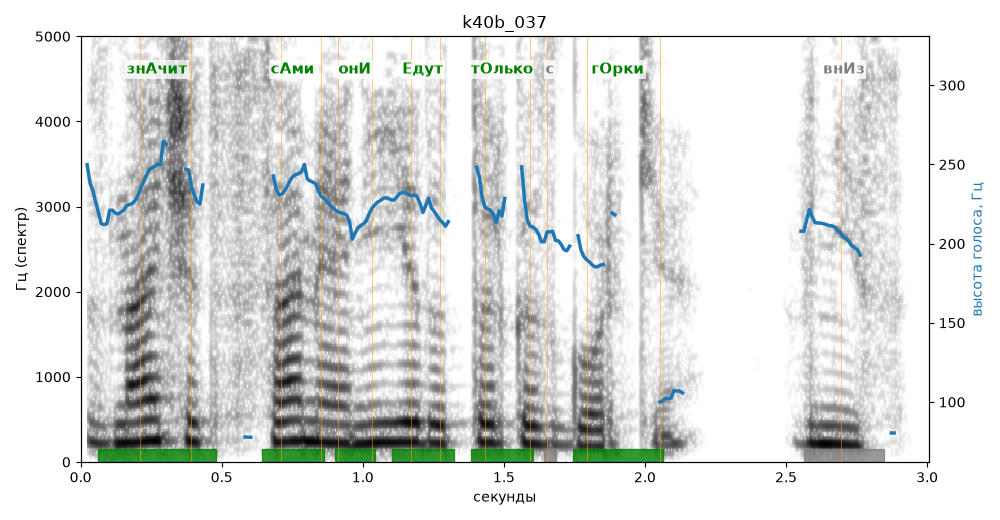

# k40b_037

Эталон: Значит, сами они едут только с горки. Вниз.
Распознано: Значит, сами они едут только с горки, вниз.
Слова: все совпали

## Ударения
(где нужно: ruaccent)

| слово | нужно | у голоса | |
|---|---|---|---|
| значит | знАчит | знАчит | ✓ |
| сами | сАми | сАми | ✓ |
| они | онИ | онИ | ✓ |
| едут | Едут | Едут | ✓ |
| только | тОлько | тОлько | ✓ |
| горки | гОрки | гОрки | ✓ |

## Интонация
- ✓ «значит сами они едут только с горки.» — конец фразы понижается — звучит законченно
- Диапазон голоса 15.3 полутонов (живо), средняя высота 220 Гц

## Паузы и темп
- паузы на своих местах
- Темп 6.6 слога/с (быстро)

_Синяя линия — высота голоса. Над словами заглавная буква — где ударение должно быть; красным — голос поставил не туда (уверенно), оранжевым — возможно._
