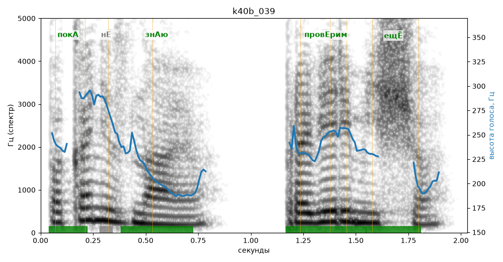

# k40b_039

Эталон: Пока не знаю. Проверим ещё!
Распознано: Пока не знаю, проверим еще.
Слова: все совпали

## Ударения
(где нужно: ruaccent)

| слово | нужно | у голоса | |
|---|---|---|---|
| пока | покА | покА | ✓ |
| знаю | знАю | знАю | ✓ |
| проверим | провЕрим | провЕрим | ✓ |
| ещё | ещЁ | ещЁ | ✓ |

## Интонация
- ✓ «пока не знаю.» — конец фразы понижается — звучит законченно
- ✗ «проверим ещё!» — восклицание звучит ровно, без эмоции
- Диапазон голоса 7.5 полутонов (живо), средняя высота 232 Гц

## Паузы и темп
- паузы на своих местах
- Темп 6.8 слога/с (быстро)

_Синяя линия — высота голоса. Над словами заглавная буква — где ударение должно быть; красным — голос поставил не туда (уверенно), оранжевым — возможно._
