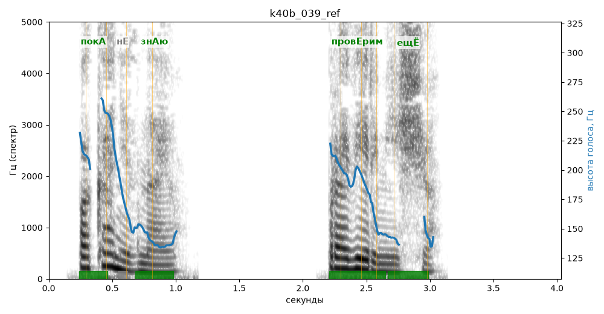

# k40b_039_ref

Голос: **edge:ru-RU-SvetlanaNeural** · длительность 4.0 с
Эталон: Пока не знаю. Проверим ещё!
Распознано: Пока не знаю. Проверим еще.
Слова: все совпали

## Ударения
(где нужно: ruaccent)

| слово | нужно | у голоса | |
|---|---|---|---|
| пока | покА | покА | ✓ |
| знаю | знАю | знАю | ✓ |
| проверим | провЕрим | провЕрим | ✓ |
| ещё | ещЁ | ещЁ | ✓ |

## Интонация
- ✓ «пока не знаю.» — конец фразы понижается — звучит законченно
- ✓ «проверим ещё!» — выделено слово «проверим» (+4.6 пт)
- Диапазон голоса 10.3 полутонов (живо), средняя высота 160 Гц

## Паузы и темп
- паузы на своих местах
- Темп 5.9 слога/с (нормально)

_Синяя линия — высота голоса. Над словами заглавная буква — где ударение должно быть; красным — голос поставил не туда (уверенно), оранжевым — возможно._
