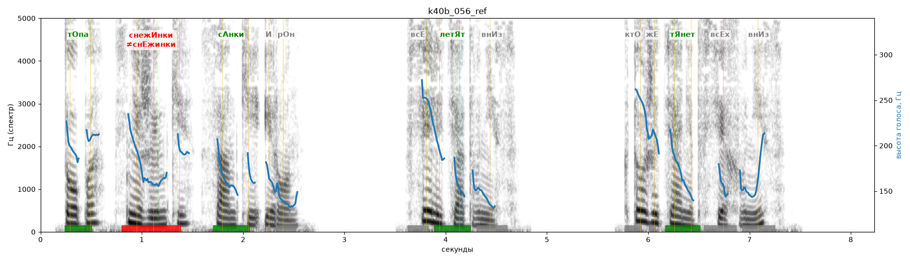

# k40b_056_ref

Голос: **edge:ru-RU-SvetlanaNeural** · длительность 8.2 с
Эталон: Топа, снежинки, санки и Рон. Все летят вниз. Кто же тянет всех вниз?
Распознано: Топа, снежимки, санки ирон. Все летят вниз. Кто же тянет всех вниз?
Расхождения в словах: «снежинки» → «снежимки»; «и рон» → «ирон»

## Ударения
(где нужно: ruaccent)

| слово | нужно | у голоса | |
|---|---|---|---|
| топа | тОпа | тОпа | ✓ |
| снежинки | снежИнки | снЕжинки | ✗ ОШИБКА |
| санки | сАнки | сАнки | ✓ |
| летят | летЯт | летЯт | ✓ |
| тянет | тЯнет | тЯнет | ✓ |

## Интонация
- ✓ «топа снежинки санки и рон.» — конец фразы понижается — звучит законченно
- ✓ «все летят вниз.» — конец фразы понижается — звучит законченно
- ✓ «кто же тянет всех вниз?» — конец фразы понижается — звучит законченно
- Диапазон голоса 10.3 полутонов (живо), средняя высота 165 Гц

## Паузы и темп
- паузы на своих местах
- Темп 4.8 слога/с (нормально)

_Синяя линия — высота голоса. Над словами заглавная буква — где ударение должно быть; красным — голос поставил не туда (уверенно), оранжевым — возможно._
