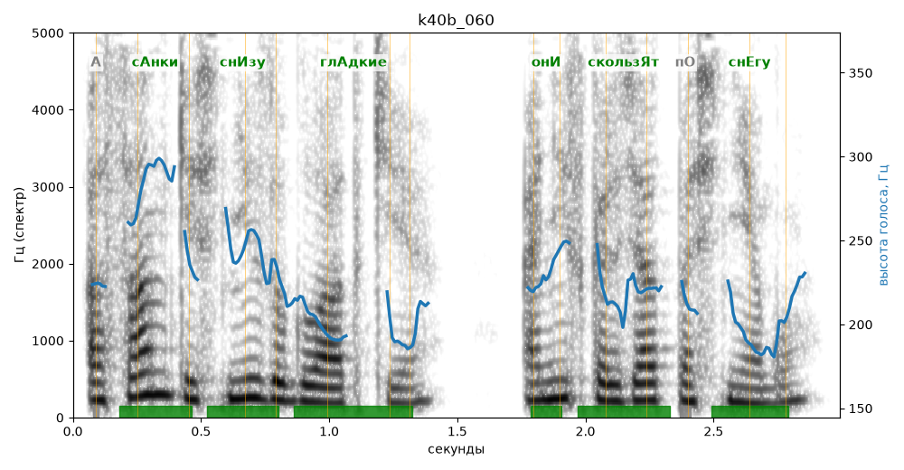

# k40b_060

Эталон: А санки снизу гладкие. Они скользят по снегу.
Распознано: А санки снизу гладкие, а не скользят по снегу.
Расхождения в словах: «они» → «а не»

## Ударения
(где нужно: ruaccent)

| слово | нужно | у голоса | |
|---|---|---|---|
| санки | сАнки | сАнки | ✓ |
| снизу | снИзу | снИзу | ✓ |
| гладкие | глАдкие | глАдкие | ✓ |
| они | онИ | онИ | ✓ |
| скользят | скользЯт | скользЯт | ✓ |
| снегу | снЕгу | снЕгу | ✓ |

## Интонация
- ✓ «а санки снизу гладкие.» — конец фразы понижается — звучит законченно
- ✓ «они скользят по снегу.» — конец фразы понижается — звучит законченно
- Диапазон голоса 7.8 полутонов (живо), средняя высота 220 Гц

## Паузы и темп
- паузы на своих местах
- Темп 6.7 слога/с (быстро)

_Синяя линия — высота голоса. Над словами заглавная буква — где ударение должно быть; красным — голос поставил не туда (уверенно), оранжевым — возможно._
