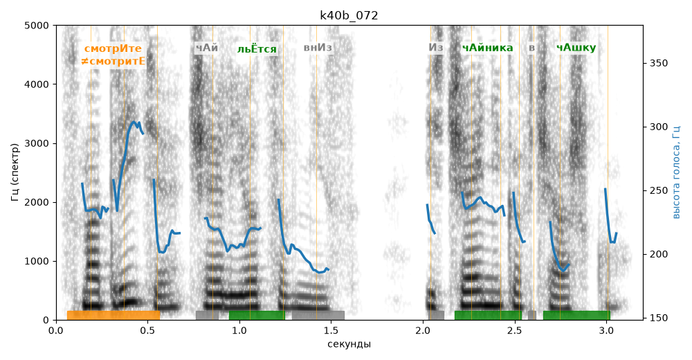

# k40b_072

Эталон: Смотрите, чай льётся вниз. Из чайника в чашку.
Распознано: Смотрите, чай льется вниз из чайников чашку.
Расхождения в словах: «чайника в» → «чайников»

## Ударения
(где нужно: ruaccent)

| слово | нужно | у голоса | |
|---|---|---|---|
| смотрите | смотрИте | смотритЕ | ✗? возможно — послушать |
| льётся | льЁтся | льЁтся | ✓ |
| чайника | чАйника | чАйника | ✓ |
| чашку | чАшку | чАшку | ✓ |

## Интонация
- ✓ «смотрите чай льётся вниз.» — конец фразы понижается — звучит законченно
- ✓ «из чайника в чашку.» — конец фразы понижается — звучит законченно
- Диапазон голоса 7.8 полутонов (живо), средняя высота 219 Гц

## Паузы и темп
- паузы на своих местах
- Темп 6.1 слога/с (нормально)

_Синяя линия — высота голоса. Над словами заглавная буква — где ударение должно быть; красным — голос поставил не туда (уверенно), оранжевым — возможно._
