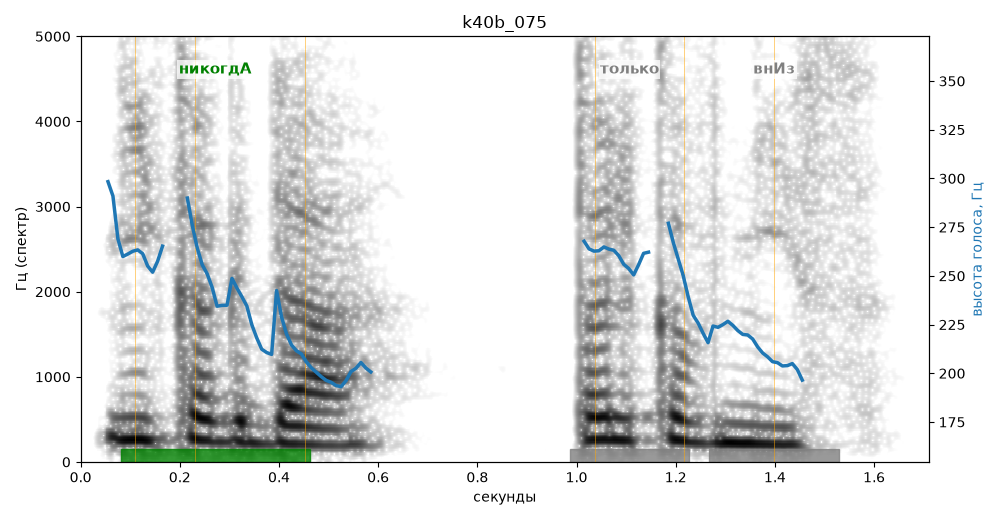

# k40b_075

Эталон: Никогда. Только вниз.
Распознано: никогда, только вниз.
Слова: все совпали

## Ударения
(где нужно: ruaccent)

| слово | нужно | у голоса | |
|---|---|---|---|
| никогда | никогдА | никогдА | ✓ |
| только | только | тОлько | нет эталона |

## Интонация
- ✓ «никогда.» — конец фразы понижается — звучит законченно
- ✓ «только вниз.» — конец фразы понижается — звучит законченно
- Диапазон голоса 5.6 полутонов (нормально), средняя высота 229 Гц

## Паузы и темп
- паузы на своих местах
- Темп 6.5 слога/с (нормально)

_Синяя линия — высота голоса. Над словами заглавная буква — где ударение должно быть; красным — голос поставил не туда (уверенно), оранжевым — возможно._
