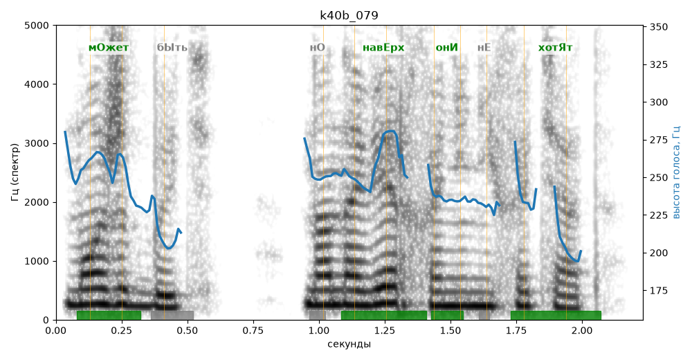

# k40b_079

Эталон: Может быть. Но наверх они не хотят.
Распознано: Может быть, но наверх они не хотят.
Слова: все совпали

## Ударения
(где нужно: ruaccent)

| слово | нужно | у голоса | |
|---|---|---|---|
| может | мОжет | мОжет | ✓ |
| наверх | навЕрх | навЕрх | ✓ |
| они | онИ | онИ | ✓ |
| хотят | хотЯт | хотЯт | ✓ |

## Интонация
- ✓ «может быть.» — конец фразы понижается — звучит законченно
- ✓ «но наверх они не хотят.» — конец фразы понижается — звучит законченно
- Диапазон голоса 5.3 полутонов (нормально), средняя высота 244 Гц

## Паузы и темп
- паузы на своих местах
- Темп 7.1 слога/с (быстро)

_Синяя линия — высота голоса. Над словами заглавная буква — где ударение должно быть; красным — голос поставил не туда (уверенно), оранжевым — возможно._
