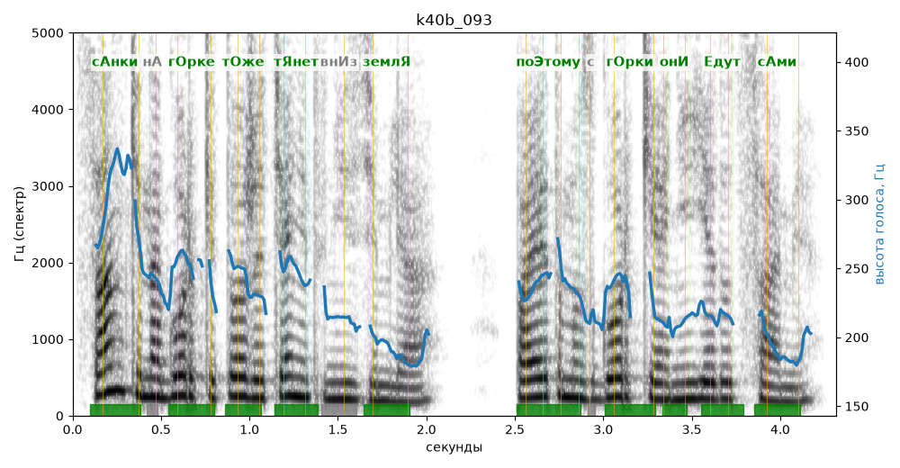

# k40b_093

Эталон: Санки на горке тоже тянет вниз Земля. Поэтому с горки они едут сами!
Распознано: Санки на горке тоже тянет вниз земля, поэтому с горки они едут сами.
Слова: все совпали

## Ударения
(где нужно: ruaccent)

| слово | нужно | у голоса | |
|---|---|---|---|
| санки | сАнки | сАнки | ✓ |
| горке | гОрке | гОрке | ✓ |
| тоже | тОже | тОже | ✓ |
| тянет | тЯнет | тЯнет | ✓ |
| земля | землЯ | землЯ | ✓ |
| поэтому | поЭтому | поЭтому | ✓ |
| горки | гОрки | гОрки | ✓ |
| они | онИ | онИ | ✓ |
| едут | Едут | Едут | ✓ |
| сами | сАми | сАми | ✓ |

## Интонация
- ✓ «санки на горке тоже тянет вниз земля.» — конец фразы понижается — звучит законченно
- ✓ «поэтому с горки они едут сами!» — выделено слово «поэтому» (+2.1 пт)
- Диапазон голоса 8.5 полутонов (живо), средняя высота 225 Гц

## Паузы и темп
- паузы на своих местах
- Темп 7.3 слога/с (быстро)

_Синяя линия — высота голоса. Над словами заглавная буква — где ударение должно быть; красным — голос поставил не туда (уверенно), оранжевым — возможно._
