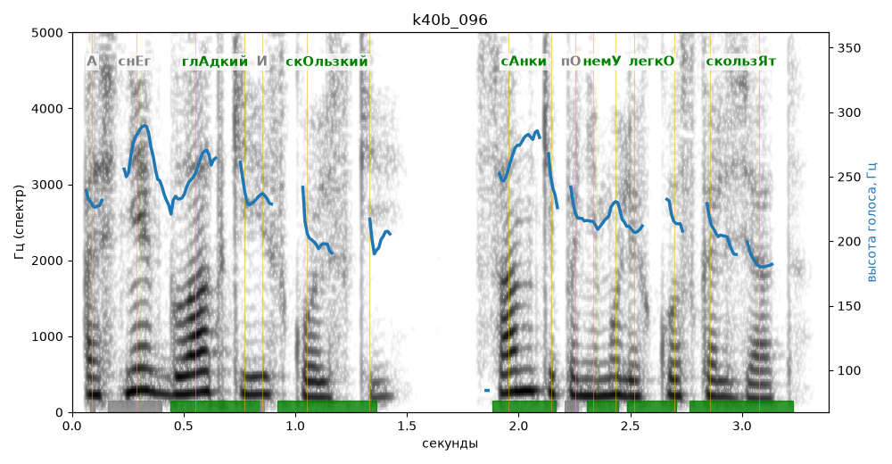

# k40b_096

Эталон: А снег гладкий и скользкий. Санки по нему легко скользят.
Распознано: О снег гладкие и скользкие, санки по нему легко скользят.
Расхождения в словах: «а» → «о»; «гладкий» → «гладкие»; «скользкий» → «скользкие»

## Ударения
(где нужно: ruaccent)

| слово | нужно | у голоса | |
|---|---|---|---|
| гладкий | глАдкий | глАдкий | ✓ |
| скользкий | скОльзкий | скОльзкий | ✓ |
| санки | сАнки | сАнки | ✓ |
| нему | немУ | немУ | ✓ |
| легко | легкО | легкО | ✓ |
| скользят | скользЯт | скользЯт | ✓ |

## Интонация
- ✓ «а снег гладкий и скользкий.» — конец фразы понижается — звучит законченно
- ✓ «санки по нему легко скользят.» — конец фразы понижается — звучит законченно
- Диапазон голоса 7.5 полутонов (живо), средняя высота 228 Гц

## Паузы и темп
- паузы на своих местах
- Темп 6.1 слога/с (нормально)

_Синяя линия — высота голоса. Над словами заглавная буква — где ударение должно быть; красным — голос поставил не туда (уверенно), оранжевым — возможно._
