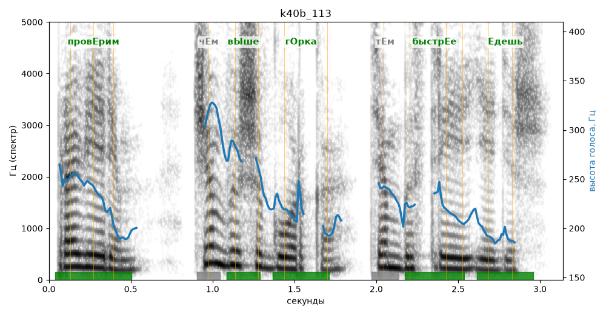

# k40b_113

Эталон: Проверим! Чем выше горка, тем быстрее едешь.
Распознано: Проверим, чем выше горка, тем быстрее едешь.
Слова: все совпали

## Ударения
(где нужно: ruaccent)

| слово | нужно | у голоса | |
|---|---|---|---|
| проверим | провЕрим | провЕрим | ✓ |
| выше | вЫше | вЫше | ✓ |
| горка | гОрка | гОрка | ✓ |
| быстрее | быстрЕе | быстрЕе | ✓ |
| едешь | Едешь | Едешь | ✓ |

## Интонация
- ✗ «проверим!» — восклицание звучит ровно, без эмоции
- ✓ «чем выше горка тем быстрее едешь.» — конец фразы понижается — звучит законченно
- Диапазон голоса 8.1 полутонов (живо), средняя высота 221 Гц

## Паузы и темп
- паузы на своих местах
- Темп 6.2 слога/с (нормально)

_Синяя линия — высота голоса. Над словами заглавная буква — где ударение должно быть; красным — голос поставил не туда (уверенно), оранжевым — возможно._
