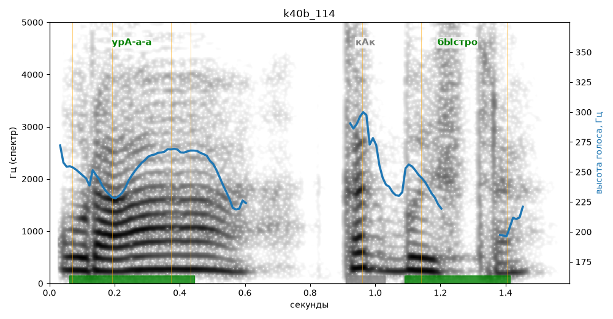

# k40b_114

Эталон: Ура-а-а! Как быстро!
Распознано: Ура! Как быстро!
Расхождения в словах: «ура-а-а» → «ура»

## Ударения
(где нужно: ruaccent)

| слово | нужно | у голоса | |
|---|---|---|---|
| ура-а-а | урА-а-а | урА-а-а | ✓ |
| быстро | бЫстро | бЫстро | ✓ |

## Интонация
- ✗ «ура-а-а!» — восклицание звучит ровно, без эмоции
- ✓ «как быстро!» — выделено слово «как» (+2.9 пт)
- Диапазон голоса 5.3 полутонов (нормально), средняя высота 249 Гц

## Паузы и темп
- паузы на своих местах
- Темп 7.9 слога/с (быстро)

_Синяя линия — высота голоса. Над словами заглавная буква — где ударение должно быть; красным — голос поставил не туда (уверенно), оранжевым — возможно._
