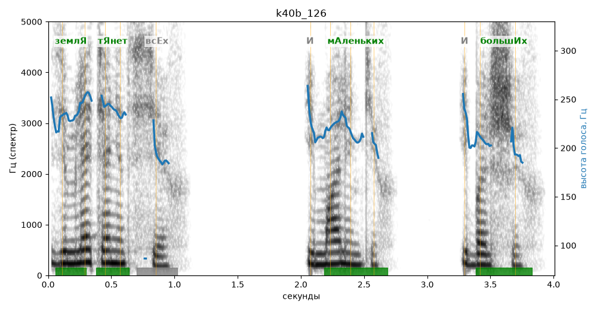

# k40b_126

Эталон: Земля тянет всех: и маленьких, и больших.
Распознано: Земля тянет всех и маленьких и больших.
Слова: все совпали

## Ударения
(где нужно: ruaccent)

| слово | нужно | у голоса | |
|---|---|---|---|
| земля | землЯ | землЯ | ✓ |
| тянет | тЯнет | тЯнет | ✓ |
| маленьких | мАленьких | мАленьких | ✓ |
| больших | большИх | большИх | ✓ |

## Интонация
- ✓ «земля тянет всех и маленьких и больших.» — конец фразы понижается — звучит законченно
- Диапазон голоса 5.3 полутонов (нормально), средняя высота 220 Гц

## Паузы и темп
- паузы на своих местах
- Темп 5.7 слога/с (нормально)

_Синяя линия — высота голоса. Над словами заглавная буква — где ударение должно быть; красным — голос поставил не туда (уверенно), оранжевым — возможно._
