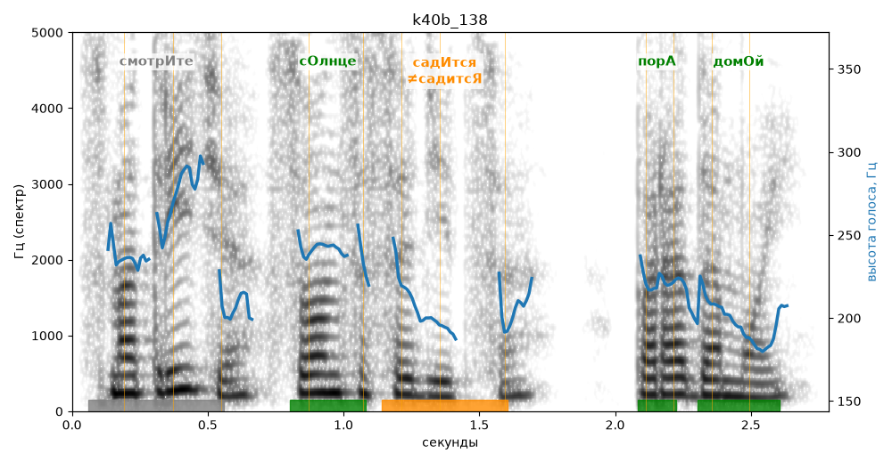

# k40b_138

Эталон: Смотрите, солнце садится. Пора домой.
Распознано: Смотрите, солнце садится. Парадомой.
Расхождения в словах: «пора домой» → «парадомой»

## Ударения
(где нужно: ruaccent)

| слово | нужно | у голоса | |
|---|---|---|---|
| смотрите | смотрИте | смотритЕ | ? не разобрать |
| солнце | сОлнце | сОлнце | ✓ |
| садится | садИтся | садитсЯ | ✗? возможно — послушать |
| пора | порА | порА | ✓ |
| домой | домОй | домОй | ✓ |

## Интонация
- ✓ «смотрите солнце садится.» — конец фразы понижается — звучит законченно
- ✓ «пора домой.» — конец фразы понижается — звучит законченно
- Диапазон голоса 7.0 полутонов (живо), средняя высота 218 Гц

## Паузы и темп
- паузы на своих местах
- Темп 6.6 слога/с (быстро)

_Синяя линия — высота голоса. Над словами заглавная буква — где ударение должно быть; красным — голос поставил не туда (уверенно), оранжевым — возможно._
