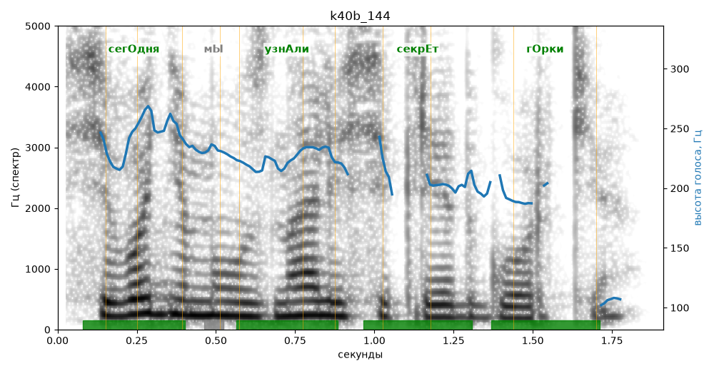

# k40b_144

Эталон: Сегодня мы узнали секрет горки.
Распознано: Сегодня мы узнали секрет горки.
Слова: все совпали

## Ударения
(где нужно: ruaccent)

| слово | нужно | у голоса | |
|---|---|---|---|
| сегодня | сегОдня | сегОдня | ✓ |
| узнали | узнАли | узнАли | ✓ |
| секрет | секрЕт | секрЕт | ✓ |
| горки | гОрки | гОрки | ✓ |

## Интонация
- ✓ «сегодня мы узнали секрет горки.» — конец фразы понижается — звучит законченно
- Диапазон голоса 13.0 полутонов (живо), средняя высота 222 Гц

## Паузы и темп
- паузы на своих местах
- Темп 6.7 слога/с (быстро)

_Синяя линия — высота голоса. Над словами заглавная буква — где ударение должно быть; красным — голос поставил не туда (уверенно), оранжевым — возможно._
