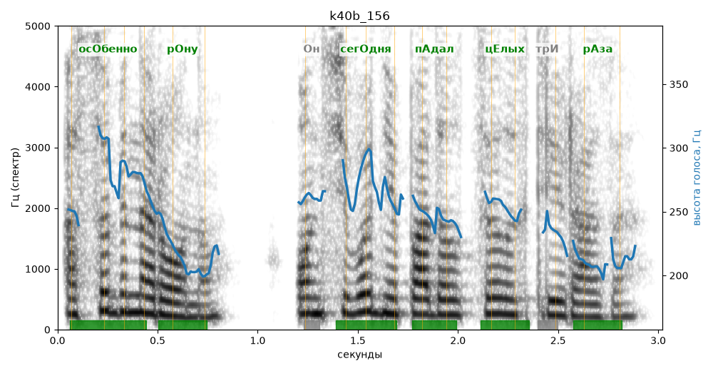

# k40b_156

Эталон: Особенно Рону. Он сегодня падал целых три раза!
Распознано: Особенно рону. Он сегодня падал целых три раза.
Слова: все совпали

## Ударения
(где нужно: ruaccent)

| слово | нужно | у голоса | |
|---|---|---|---|
| особенно | осОбенно | осОбенно | ✓ |
| рону | рОну | рОну | ✓ |
| сегодня | сегОдня | сегОдня | ✓ |
| падал | пАдал | пАдал | ✓ |
| целых | цЕлых | цЕлых | ✓ |
| раза | рАза | рАза | ✓ |

## Интонация
- ✓ «особенно рону.» — конец фразы понижается — звучит законченно
- ✗ «он сегодня падал целых три раза!» — восклицание звучит ровно, без эмоции
- Диапазон голоса 6.2 полутонов (нормально), средняя высота 249 Гц

## Паузы и темп
- паузы на своих местах
- Темп 7.5 слога/с (быстро)

_Синяя линия — высота голоса. Над словами заглавная буква — где ударение должно быть; красным — голос поставил не туда (уверенно), оранжевым — возможно._
