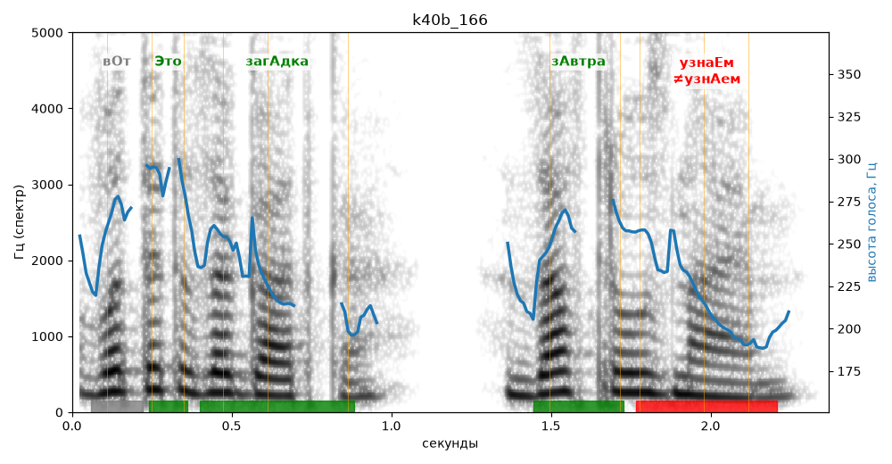

# k40b_166

Эталон: Вот это загадка! Завтра узнаем!
Распознано: Вот эта загадка. Завтра узнаем.
Расхождения в словах: «это» → «эта»

## Ударения
(где нужно: ruaccent)

| слово | нужно | у голоса | |
|---|---|---|---|
| это | Это | Это | ✓ |
| загадка | загАдка | загАдка | ✓ |
| завтра | зАвтра | зАвтра | ✓ |
| узнаем | узнаЕм | узнАем | ✗ ОШИБКА |

## Интонация
- ✓ «вот это загадка!» — выделено слово «это» (+2.5 пт)
- ✗ «завтра узнаем!» — восклицание звучит ровно, без эмоции
- Диапазон голоса 6.8 полутонов (нормально), средняя высота 235 Гц

## Паузы и темп
- паузы на своих местах
- Темп 6.9 слога/с (быстро)

_Синяя линия — высота голоса. Над словами заглавная буква — где ударение должно быть; красным — голос поставил не туда (уверенно), оранжевым — возможно._
