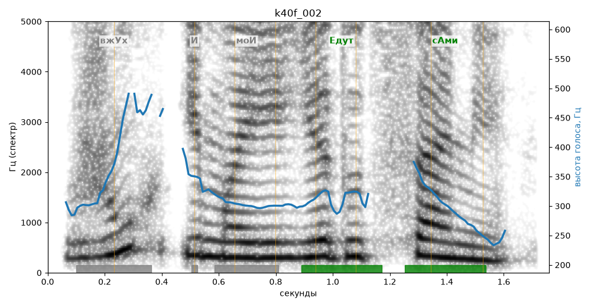

# k40f_002

Эталон: Вжух! И мои едут! Сами!
Распознано: Вжух и мои едут сами.
Слова: все совпали

## Ударения
(где нужно: ruaccent)

| слово | нужно | у голоса | |
|---|---|---|---|
| мои | моИ | мОи | ? не разобрать |
| едут | Едут | Едут | ✓ |
| сами | сАми | сАми | ✓ |

## Интонация
- ✓ «и мои едут!» — выделено слово «и» (+2.2 пт)
- Диапазон голоса 10.8 полутонов (живо), средняя высота 305 Гц

## Паузы и темп
- после «вжух!» пауза всего 0.14 с — фразы слипаются
- после «едут!» пауза всего 0.08 с — фразы слипаются
- Темп 5.6 слога/с (нормально)

_Синяя линия — высота голоса. Над словами заглавная буква — где ударение должно быть; красным — голос поставил не туда (уверенно), оранжевым — возможно._
