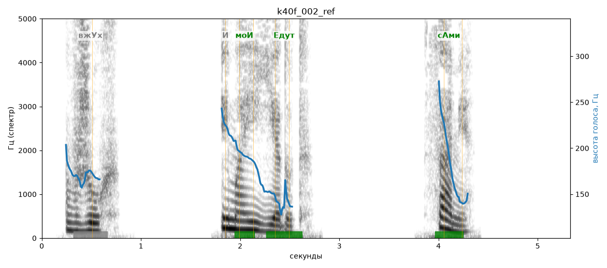

# k40f_002_ref

Голос: **edge:ru-RU-SvetlanaNeural** · длительность 5.3 с
Эталон: Вжух! И мои едут! Сами!
Распознано: Вжух. И мои едут. Сами.
Слова: все совпали

## Ударения
(где нужно: ruaccent)

| слово | нужно | у голоса | |
|---|---|---|---|
| мои | моИ | моИ | ✓ |
| едут | Едут | Едут | ✓ |
| сами | сАми | сАми | ✓ |

## Интонация
- ✓ «и мои едут!» — выделено слово «и» (+3.4 пт)
- Диапазон голоса 9.0 полутонов (живо), средняя высота 170 Гц

## Паузы и темп
- паузы на своих местах
- Темп 5.7 слога/с (нормально)

_Синяя линия — высота голоса. Над словами заглавная буква — где ударение должно быть; красным — голос поставил не туда (уверенно), оранжевым — возможно._
