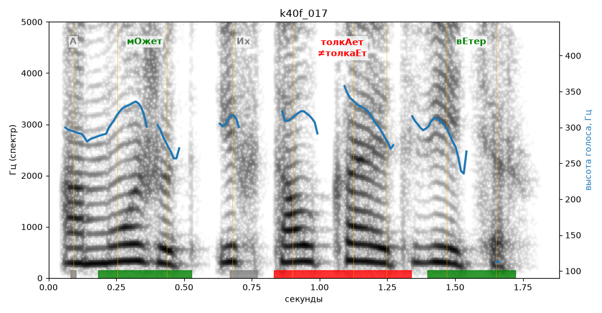

# k40f_017

Эталон: А может, их толкает ветер?
Распознано: А может их толкает ветер.
Слова: все совпали

## Ударения
(где нужно: ruaccent)

| слово | нужно | у голоса | |
|---|---|---|---|
| может | мОжет | мОжет | ✓ |
| толкает | толкАет | толкаЕт | ✗ ОШИБКА |
| ветер | вЕтер | вЕтер | ✓ |

## Интонация
- ✗ «а может их толкает ветер?» — нет вопросительного подъёма (самое высокое место — «толкает», в начале) — звучит как утверждение
- Диапазон голоса 4.6 полутонов (нормально), средняя высота 304 Гц

## Паузы и темп
- паузы на своих местах
- Темп 5.5 слога/с (нормально)

_Синяя линия — высота голоса. Над словами заглавная буква — где ударение должно быть; красным — голос поставил не туда (уверенно), оранжевым — возможно._
