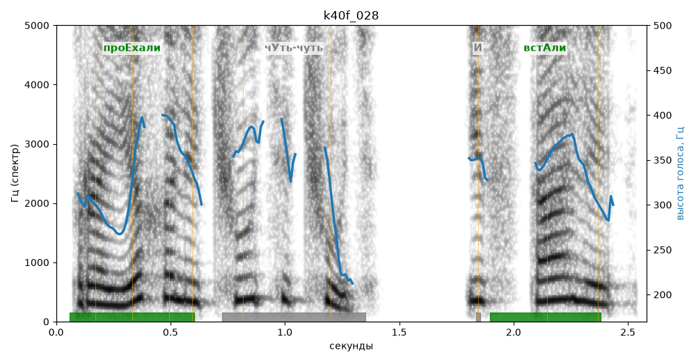

# k40f_028

Эталон: Проехали чуть-чуть. И встали!
Распознано: Проехали чуть-чуть и встали.
Слова: все совпали

## Ударения
(где нужно: ruaccent)

| слово | нужно | у голоса | |
|---|---|---|---|
| проехали | проЕхали | проЕхали | ✓ |
| чуть-чуть | чУть-чуть | чуть-чУть | ? не разобрать |
| встали | встАли | встАли | ✓ |

## Интонация
- ✗ «проехали чуть-чуть.» — конец фразы не понижается — звучит незаконченно / как перечисление
- ✗ «и встали!» — восклицание звучит ровно, без эмоции
- Диапазон голоса 8.2 полутонов (живо), средняя высота 346 Гц

## Паузы и темп
- паузы на своих местах
- Темп 4.9 слога/с (нормально)

_Синяя линия — высота голоса. Над словами заглавная буква — где ударение должно быть; красным — голос поставил не туда (уверенно), оранжевым — возможно._
