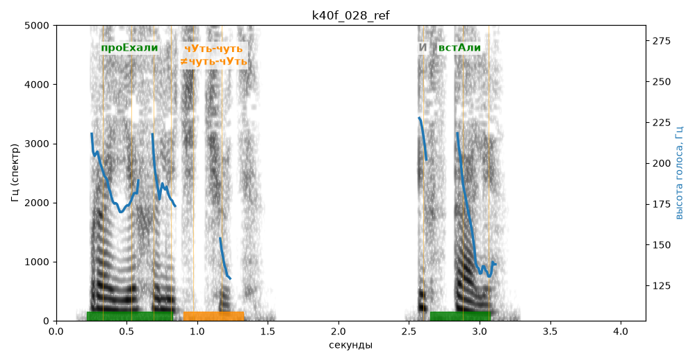

# k40f_028_ref

Голос: **edge:ru-RU-SvetlanaNeural** · длительность 4.2 с
Эталон: Проехали чуть-чуть. И встали!
Распознано: проехали чуть-чуть и встали
Слова: все совпали

## Ударения
(где нужно: ruaccent)

| слово | нужно | у голоса | |
|---|---|---|---|
| проехали | проЕхали | проЕхали | ✓ |
| чуть-чуть | чУть-чуть | чуть-чУть | ✗? возможно — послушать |
| встали | встАли | встАли | ✓ |

## Интонация
- ✓ «проехали чуть-чуть.» — конец фразы понижается — звучит законченно
- ✓ «и встали!» — выделено слово «и» (+3.6 пт)
- Диапазон голоса 8.7 полутонов (живо), средняя высота 178 Гц

## Паузы и темп
- паузы на своих местах
- Темп 5.7 слога/с (нормально)

_Синяя линия — высота голоса. Над словами заглавная буква — где ударение должно быть; красным — голос поставил не туда (уверенно), оранжевым — возможно._
