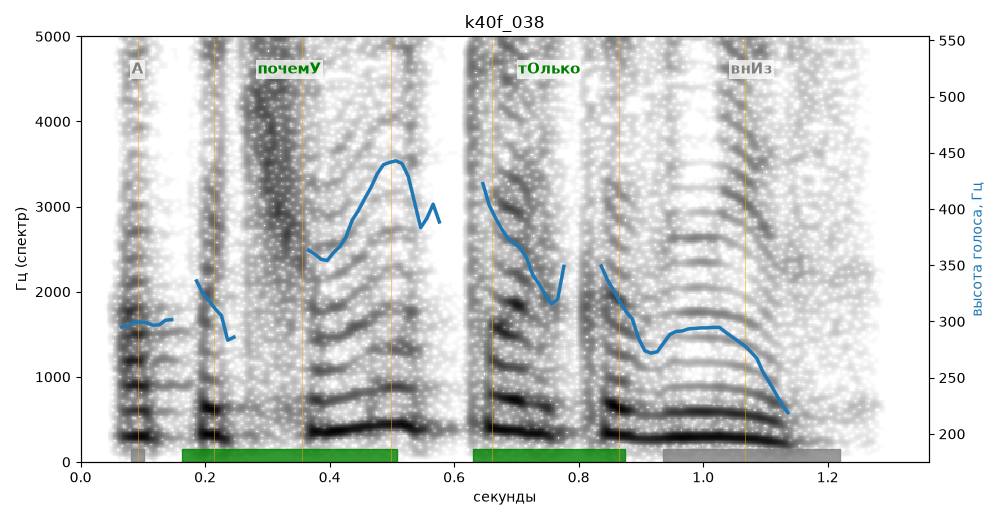

# k40f_038

Эталон: А почему только вниз?
Распознано: А почему только вниз?
Слова: все совпали

## Ударения
(где нужно: ruaccent)

| слово | нужно | у голоса | |
|---|---|---|---|
| почему | почемУ | почемУ | ✓ |
| только | тОлько | тОлько | ✓ |

## Интонация
- ✗ «а почему только вниз?» — нет вопросительного подъёма (самое высокое место — «почему», в начале) — звучит как утверждение
- Диапазон голоса 9.0 полутонов (живо), средняя высота 317 Гц

## Паузы и темп
- паузы на своих местах
- Темп 6.1 слога/с (нормально)

_Синяя линия — высота голоса. Над словами заглавная буква — где ударение должно быть; красным — голос поставил не туда (уверенно), оранжевым — возможно._
