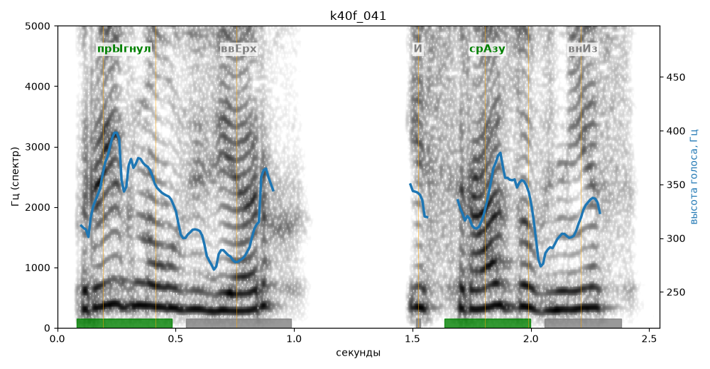

# k40f_041

Эталон: Прыгнул вверх. И сразу вниз!
Распознано: Пригнал вверх и сразу вниз.
Расхождения в словах: «прыгнул» → «пригнал»

## Ударения
(где нужно: ruaccent)

| слово | нужно | у голоса | |
|---|---|---|---|
| прыгнул | прЫгнул | прЫгнул | ✓ |
| сразу | срАзу | срАзу | ✓ |

## Интонация
- ✓ «прыгнул вверх.» — конец фразы понижается — звучит законченно
- ✗ «и сразу вниз!» — восклицание звучит ровно, без эмоции
- Диапазон голоса 5.1 полутонов (нормально), средняя высота 326 Гц

## Паузы и темп
- паузы на своих местах
- Темп 3.9 слога/с (медленно)

_Синяя линия — высота голоса. Над словами заглавная буква — где ударение должно быть; красным — голос поставил не туда (уверенно), оранжевым — возможно._
