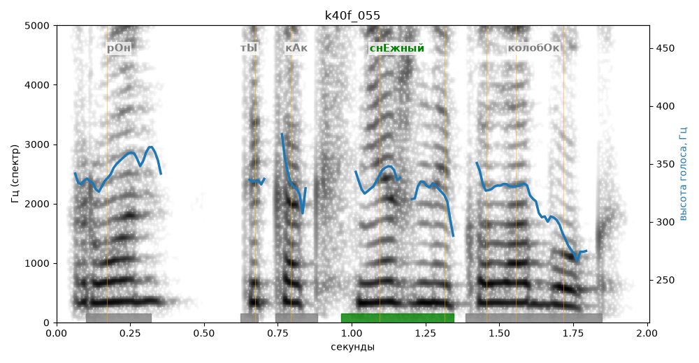

# k40f_055

Эталон: Рон, ты как снежный колобок!
Распознано: Рон, ты как снежный колобок.
Слова: все совпали

## Ударения
(где нужно: ruaccent)

| слово | нужно | у голоса | |
|---|---|---|---|
| снежный | снЕжный | снЕжный | ✓ |
| колобок | колобОк | кОлобок | ? не разобрать |

## Интонация
- ✗ «рон ты как снежный колобок!» — восклицание звучит ровно, без эмоции
- Диапазон голоса 4.4 полутонов (монотонно, как робот), средняя высота 332 Гц

## Паузы и темп
- паузы на своих местах
- Темп 5.5 слога/с (нормально)

_Синяя линия — высота голоса. Над словами заглавная буква — где ударение должно быть; красным — голос поставил не туда (уверенно), оранжевым — возможно._
