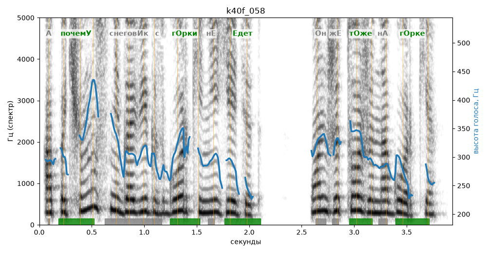

# k40f_058

Эталон: А почему снеговик с горки не едет? Он же тоже на горке!
Распознано: А почему с него виг с горки не едет? Он же тоже на горке.
Расхождения в словах: «снеговик» → «с него виг»

## Ударения
(где нужно: ruaccent)

| слово | нужно | у голоса | |
|---|---|---|---|
| почему | почемУ | почемУ | ✓ |
| снеговик | снеговИк | снЕговик | ? не разобрать |
| горки | гОрки | гОрки | ✓ |
| едет | Едет | Едет | ✓ |
| тоже | тОже | тОже | ✓ |
| горке | гОрке | гОрке | ✓ |

## Интонация
- ✗ «а почему снеговик с горки не едет?» — нет вопросительного подъёма (самое высокое место — «почему», в начале) — звучит как утверждение
- ✓ «он же тоже на горке!» — выделено слово «тоже» (+2.7 пт)
- Диапазон голоса 6.7 полутонов (нормально), средняя высота 298 Гц

## Паузы и темп
- паузы на своих местах
- Темп 6.4 слога/с (нормально)

_Синяя линия — высота голоса. Над словами заглавная буква — где ударение должно быть; красным — голос поставил не туда (уверенно), оранжевым — возможно._
